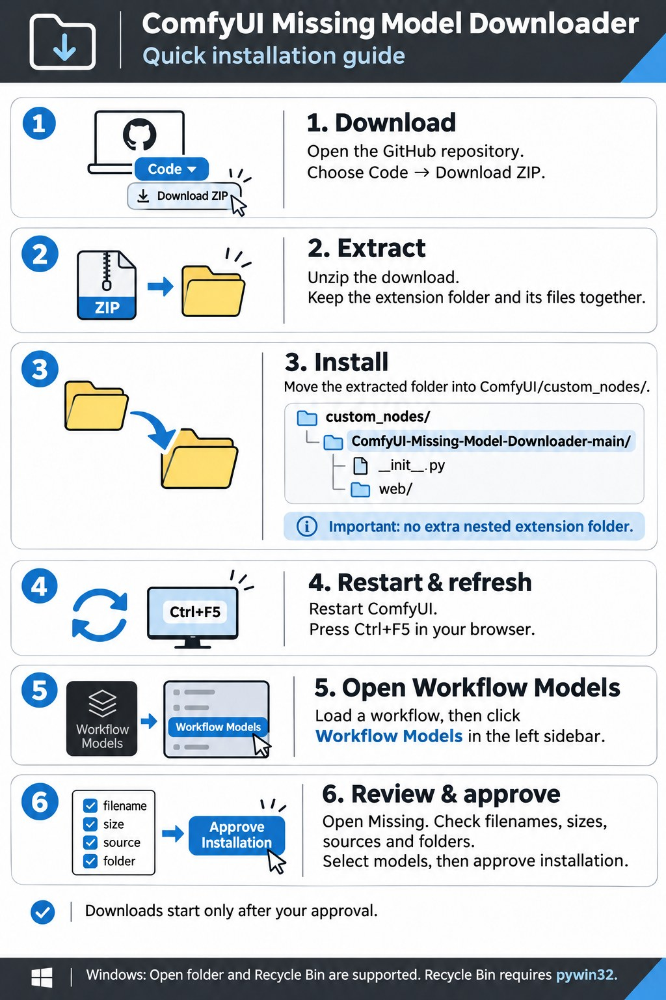

# ComfyUI Missing Model Downloader

Review, download and manage the models used by your current workflow.

## Quick installation guide

## Install

1. Download this repository as a ZIP and extract it.
2. Move the extracted extension folder (for example, `ComfyUI-Missing-Model-Downloader-main`) into `ComfyUI/custom_nodes`. Make sure `__init__.py` and `web/` are directly inside that folder, with no extra nested extension folder.
3. Restart ComfyUI, then hard-refresh your browser (Ctrl+F5).
4. Open a workflow and click **Workflow Models** in the left sidebar.

## Download missing models

Open the **Missing** tab. Check filenames, sizes, sources and destination folders. Use **Select all** or select individual models, then click **Approve & install selected**.

Workflow model links are checked first, followed by exact matches in the locally installed official template catalogue. When no source is available, the extension can search Hugging Face and then Civitai for exact filename matches. You can also enter a model page or file link from either service. Review the repository and version, choose a source, and approve the download. A filename match alone does not prove a model is authentic or compatible.

No model weights download without approval. Metadata lookups and source searches may contact these services before approval. Gated files, authentication requirements, API limits and unavailable links may prevent downloading. No account tokens are collected by this extension.

Downloads use the model role to select the configured ComfyUI folder. Existing files are skipped. Progress, downloaded bytes and remaining models remain available while the panel is hidden. Closing the panel does not stop downloads; stopping ComfyUI does. Failed or cancelled downloads must be retried; partial-download resume is not supported.

## Import models downloaded in your browser

If Hugging Face denies access, open **Source & destination → Open on Hugging Face** on the missing model. Failed Hugging Face downloads also show a link when access is denied. Sign in on Hugging Face and request model access if needed, then download the files into one local folder.

In **Workflow Models → Missing → Import from folder**, paste the full folder path and click **Preview files**. The preview matches exact filenames in that folder and shows each destination. Click **Approve & copy files** to install them. Originals are kept, and existing models are not overwritten. Folder import is available from the ComfyUI computer only. The extension does not use your browser login or ask for a token.

## Manage installed models

The **Installed** tab lists installed models used by this workflow. **Open folder** opens the actual containing folder. Select models or use a card's Recycle Bin icon to review a removal confirmation. Files are moved only after confirmation. Other workflows may use the same files. Restore removed files through Windows Recycle Bin when needed.

Open folder and Recycle Bin currently require Windows. Recycling requires `pywin32` in ComfyUI's Python environment. There is no permanent-delete fallback. Model downloads and generation must finish before recycling files.

## Panel controls

Missing and Installed lists are separate. Search filters the current list. The panel opens from the left, adapts to the list height, and has a bottom drag handle for manual resizing. It hides after 12 seconds without activity; editing an input or reviewing deletion confirmation keeps it open. Click the sidebar icon to reopen it.

## Scope

Supports `.safetensors` and `.gguf` model filenames, including supported nested subgraphs. Custom nodes or loaders with unknown folder mappings may need manual folder selection. Supported download sources are Hugging Face and Civitai over HTTPS. File sizes can be unavailable. Sizes use decimal MB/GB.

This extension does not edit workflow nodes or connections. Models stay in normal ComfyUI model folders. Uninstall by removing this extension folder and restarting ComfyUI; downloaded models remain installed.

## Availability

This repository is currently private.

## Development

Python tests: `python -m unittest discover -s tests -v`

Frontend checks: `node tests/test_frontend.cjs` and `node tests/test_progress.cjs`

Tests use sample files and mocked services, not real model downloads. Live service availability and every custom workflow are not covered.

## License

MIT License. See [LICENSE](LICENSE).
